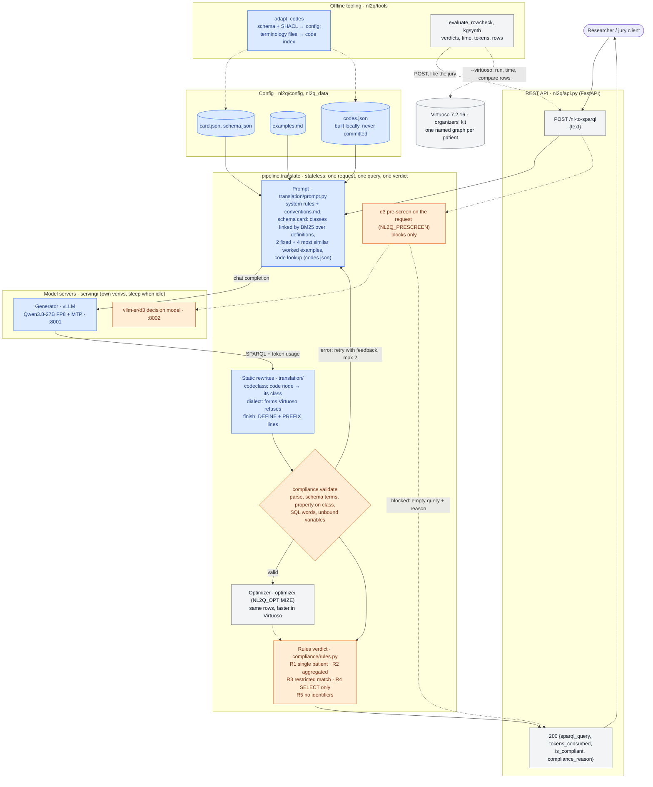

# nl2q: secure natural language to SPARQL over SPHN clinical knowledge graphs

Neural Wave 2026 · SPHN / SIB challenge "Secure NL-to-SPARQL over Clinical Knowledge Graphs".

A researcher asks a question in plain language. nl2q returns a SPARQL query over SPHN 2026.1 data in Virtuoso and says
whether that query complies with the data-access rules: no single patient, aggregates only, no unrestricted match,
SELECT only, no identifiers. The API is the one in the organizers' spec
([docs/official/API_specification.md](docs/official/API_specification.md)): `POST /nl-to-sparql` with `{"text"}` returns
`{sparql_query, tokens_consumed, is_compliant, compliance_reason}`.

- **The generator translates; code decides.** A language model (Qwen3.8-27B, open weights, served locally) translates
  literally and never refuses. The verdict comes from deterministic rules in `nl2q/compliance/`
  ([docs/official/Query_Compliance.md](docs/official/Query_Compliance.md) in code).
- **A retry can only fix form.** Only syntax errors and schema mistakes go back to the generator, so a retry never
  turns a non-compliant request into a compliant query.
- **The judged system is static.** It never runs the queries it writes and does not depend on the database it is
  pointed at. Every component that reads the data (k-anonymity, data statistics for the optimizer, the slow path) is
  behind a switch and off by default.

Design and rule-by-rule checks: [docs/design.md](docs/design.md). The 3-page report:
[docs/report/report.pdf](docs/report/report.pdf).

## Architecture
Solid arrows are the request path. Dotted arrows are optional (off by default), offline (config generation) or
evaluation only. Blue is the translation layer, orange the compliance layer, grey is shared.



## Results
Full numbers and their limits are in the report and in `docs/report/`. These are the measurements of today's `main`.

| What | Result |
|---|---|
| Unit tests (no model, no database) | 3,538 pass, 2 skipped; 1 fails in the plan path (`test_plan_values`: its resource file is out of date; the plan path is off by default) |
| Rules alone on the reference queries (`evaluate --oracle`) | 26/26 verdicts on `tests/bench/` (14 official examples, 12 own), 100/100 on the synthetic set |
| `tests/bench/` end to end (2 runs, 5k store, holdout) | 25/26 verdicts: 0 false refusal, 1 false compliant (N10, own case); 2 of 12 compliant requests return the reference's rows (0 of the 9 official ones, see [docs/report/translation-audit.md](docs/report/translation-audit.md)); 3.4 s and 8.1k tokens per request |
| Synthetic set, 100 unseen questions ([docs/report/synthetic-eval.md](docs/report/synthetic-eval.md), 3 runs) | 300/300 verdicts, 0 false compliant, 0 false refusal; 65% return the gold's rows (numbers 83%, dates 70%, value-set individuals 35%); 1.9 s and 7.9k tokens per request |

## Team
| Name | Role |
|---|---|
| Lorenzo Varese | Compliance layer (`nl2q/compliance/`: validate, rules R1–R5, d3 pre-screen, k-anonymity), optimizer (`nl2q/optimize/`), evaluation tooling, the synthetic evaluation set, serving |
| Michele Inchingolo | Translation layer (`nl2q/translation/`: prompt, worked examples, generator client, retry loop), schema config (`tools/adapt.py`), the plan path and its fine-tuned plan writer (`translation/plan.py`, `nl2q/training/`) |
| Priyanshi Chandra | Compliance testing (mutation cases in `tests/compliance/`), synthetic patients and a local SPARQL endpoint, the JSON-spec route experiment (branch `priya/synthetic-data`) |

## Repository layout
| Path | What |
|---|---|
| `nl2q/` | the application: `api` (REST endpoint) · `pipeline` (generate → check, where the two layers meet) · `schema` (schema facts both layers read) · `store` (Virtuoso client, evaluation only) · `settings` (every knob, one block per layer) |
| `nl2q/translation/` | the query: `generate` (retry loop) · `prompt` (system rules, linked schema card, code lookup, `finish`) · `examples` (worked examples from `config/examples.md`) · `codeclass` and `dialect` (static rewrites) · `plan` (optional plan path: a JSON plan compiled into SPARQL) · `grammar` (optional syntax guard) · `llm` (generator client, token counts) · `resources/` (conventions, plan examples, SPARQL grammar) · [`README.md`](nl2q/translation/README.md) (the layer's own account) |
| `nl2q/training/` | training data for the plan writer: synthetic (question, plan) pairs made by code |
| `nl2q/compliance/` | the verdict: `validate` and `judge` (`verdict`) · `rules` (R1–R5 in code) · `feedback` + `domains.json` (schema feedback for retries) · `d3` + `policy.json` (optional pre-screen) · `kanon` (optional k-anonymity, dynamic) |
| `nl2q/optimize/` | optional rewrites that keep the rows and speed up Virtuoso: `flag`, `shacl` (SHACL 2026.1 cardinalities, static), `stats` + `cost` + `slowpath` (data counts, dynamic) |
| `nl2q/config/` | written by the tools, read by the app: `schema.json` and `card.json` (`tools.adapt`) · `examples.md` (`tools.make_examples`) |
| `nl2q/tools/` | `adapt`, `codes` (config and code index) · `evaluate`, `rowcheck` (jury-style scoring, result checks) · `kgsynth` (synthetic evaluation set) · `make_examples`, `check_examples` · `fuzz_rules` (false-compliant search) · `optbench`, `metadata_scan` (optimizer measurements) · `kanon_measure`, `linkrecall`, `llm_metrics` |
| `tests/` | unit tests, one folder per layer · `bench/` (requests with expected verdicts: `official.jsonl` from the organizers, own cases per layer) · `bench_synth/` (the synthetic set and every generated candidate) |
| `serving/` | `serve_llm.sh` (generator) · `serve_api.sh` (the API as the jury calls it) · `serve_decision.sh` (d3, optional) · `serve_apertus.sh` (question writer for the synthetic set) · `idle_sleep.py` · their requirements |
| `docs/` | `design.md` (architecture, rules) · `data.md` (what the mock data looks like) · `organizer-notes.md` (organizers' answers) · `official/` (brief, API spec, rules, example queries, Virtuoso kit, guidelines) · `report/` (the 3-page report [`report.pdf`](docs/report/report.pdf), its LaTeX source in [`report/delivery/`](docs/report/delivery/) (`make`), experiment notes) · [`ideas-tracker.md`](docs/ideas-tracker.md) (every idea we tried, in order, and what happened to it) |

## Setup
Python 3.10 or later (tested on 3.12). The model servers have their own environments (below).
```bash
python -m venv .venv && . .venv/bin/activate
pip install -r requirements.txt
python -m pytest -q                         # ~1 min, no model, no database
python -m nl2q.tools.evaluate --oracle      # the rules alone on tests/bench/: 26/26
```

## Serving and inference
Three processes: the generator, the API and, for evaluation only, Virtuoso. All were tested on one NVIDIA RTX PRO 6000
(96 GB) per model.

**1. The generator** (OpenAI-compatible server, Qwen3.8-27B FP8 with MTP speculative decoding, 32k context):
```bash
python -m venv venvs/vllm && venvs/vllm/bin/pip install -r serving/requirements-llm.txt   # vLLM 0.31.0
SCRATCH=$PWD IDLE_MINUTES=0 GPU=0 PORT=8001 serving/serve_llm.sh   # weights from Hugging Face on first start
```
- `serve_llm.sh` looks for its venv, weights and caches under `SCRATCH` (default `/data/scratch/$USER`).
- `IDLE_MINUTES` puts the engine to sleep after that many idle minutes, and the API wakes it on the next request.
  0 keeps it awake: use that for judging.
- Any OpenAI-compatible server works instead: set `OPENAI_BASE_URL` and `LLM_MODEL` for the API.

**2. The API** (`POST /nl-to-sparql` on `NL2Q_API_PORT`, default 8080):
```bash
NL2Q_ONTOLOGIES=/path/to/virtuoso-kit/ontologies serving/serve_api.sh
curl -s localhost:8080/nl-to-sparql -H 'content-type: application/json' \
     -d '{"text": "How many patients had an adverse event with a fatal outcome?"}'
```
- On first start, `serve_api.sh` builds the code index `nl2q_data/codes.json` from the terminology files of the
  organizers' kit, in about 3 minutes, then reuses it. The index holds labels from licensed terminologies (SNOMED CT,
  LOINC, ICD-10-GM, CHOP), so it is never committed.
- Without the terminology files the API still runs, with the code lookup off.
- `python -m nl2q.api` starts the API without building the index.

**3. Virtuoso**, for evaluation only: the organizers' kit, see [docs/official/virtuoso-kit.md](docs/official/virtuoso-kit.md).
Point the tools at it with `SPARQL_ENDPOINT` (default `http://localhost:8890/sparql`).

**Optional servers:**
- `serving/serve_decision.sh`: the d3 pre-screen (vllm-sr/d3, :8002), used with `NL2Q_PRESCREEN=1`.
- `serving/serve_apertus.sh`: Apertus v1.5 8B (Artificialy SA's FP8-DYNAMIC checkpoint), which writes the questions
  of the synthetic set. It never translates.
  - It runs in the swiss-ai vLLM image (`ghcr.io/swiss-ai/vllm_apertus_1.5_release`), one container per GPU:
    `GPU=2 PORT=8020 UTIL=0.40 serving/serve_apertus.sh`.
  - The checkpoint must first be re-split into the file layout the Apertus loader expects; the script header explains
    how.

### Settings
Environment variables, defined in [nl2q/settings.py](nl2q/settings.py). Defaults are what the jury gets.

| Variable | Default | What |
|---|---|---|
| `OPENAI_BASE_URL`, `LLM_MODEL` | `http://localhost:8001/v1`, `qwen3.8-27b` | the generator |
| `NL2Q_LINK` | on | schema linking: the card shows the classes whose definitions match the request, plus the code lookup and validate()'s extra feedback |
| `NL2Q_CODE_CLASS` | on | static rewrite: a code node that is grouped, returned or compared becomes its class |
| `NL2Q_DIALECT` | on | static rewrite of `ROUND(x, n)` and `EXISTS … && …`, which Virtuoso refuses |
| `NL2Q_SHAPE_RULE` | on | prompt rule: OPTIONAL only for unmatched rows, a flag from another record is `EXISTS` |
| `NL2Q_SELECT_ORDER` | on | prepend `DEFINE sql:select-option "order"` |
| `NL2Q_THINK` | off | reasoning before the query: slower, more tokens |
| `NL2Q_PLAN` | off | plan path: a model writes a JSON plan and code compiles it; falls back to free generation. Needs the fine-tuned plan writer (`NL2Q_PLAN_URL`, `NL2Q_PLAN_MODEL`); see [docs/report/translation.md](docs/report/translation.md) |
| `NL2Q_GRAMMAR` | off | free generation constrained by a SPARQL grammar, so it can only write queries that parse |
| `NL2Q_OPTIMIZE` | off | optimizer passes (`NL2Q_OPT_PASSES=paths,reorder,pragma`), statically from SHACL (`NL2Q_OPT_STATS=schema`) |
| `NL2Q_PRESCREEN` | off | d3 judges the request first; it can only block |
| `NL2Q_KANON` | off | k-anonymity (`flag` or `rewrite`, groups under `NL2Q_K=10` patients); runs the query, so dynamic |
| `NL2Q_OPT_STATS=data`, `NL2Q_SLOWPATH`, `NL2Q_CARD_STATS` | off | use counts from the mock data: dynamic, kept off for the evaluation (organizers' rule) |
| `NL2Q_API_HOST`, `NL2Q_API_PORT` | `0.0.0.0`, 8080 | where the API listens |
| `NL2Q_DATA`, `NL2Q_CODES` | `nl2q_data`, `nl2q_data/codes.json` | local, gitignored files: code index, evaluation traces |

## Evaluation
```bash
python -m nl2q.tools.evaluate                                    # end to end in-process: verdicts, seconds, tokens
python -m nl2q.tools.evaluate --url http://localhost:8080        # through the API, as the jury calls it
python -m nl2q.tools.evaluate --virtuoso                         # + execution time (mean of 10) and row match
python -m nl2q.tools.evaluate --tests tests/bench_synth/kg100.jsonl --virtuoso  # the synthetic set
python -m nl2q.tools.rowcheck nl2q_data/eval_trace.jsonl         # why rows differ (never prints rows)
python -m nl2q.tools.kgsynth score nl2q_data/eval_trace.jsonl    # synthetic set by stratum and hop count
```
- Holdout is on by default: a test request never sees its own worked example.
- Rebuild the configuration from the schema and SHACL with `python -m nl2q.tools.adapt` (and `--linked` for the
  card); its docstring lists the options.

## Working together
- Before pushing: `python -m pytest -q` and `python -m nl2q.tools.evaluate --oracle` must stay green (all verdicts right).
- Each layer has an owner (Team) and its own folders in `nl2q/` and `tests/`: change only your own. The shared files
  are `pipeline.py`, `api.py`, `schema.py`, `tools/evaluate.py`, `tests/test_pipeline.py`, the README and `docs/`:
  tell the other before changing one. In `settings.py`, add knobs to your layer's block only.
- The layers meet only in `pipeline.py`, through `translation.generate`, `compliance.validate` and `compliance.judge`:
  change a signature only together, in one PR. `schema.json` is a contract too: `tools/adapt.py` writes it, both
  layers read it.
- Bench cases go to your layer's file in `tests/bench/`; `official.jsonl` holds the organizers' examples, keep it as is.
- Never loosen a rule in `nl2q/compliance/rules.py` to make a test pass: a missed non-compliant query is the costly
  error. Add the case to `tests/compliance/test_rules.py` or `tests/bench/compliance.jsonl` first.
- Worked examples come only from `docs/official/`: `python -m nl2q.tools.make_examples`, then
  `python -m nl2q.tools.check_examples` ([docs/examples-guide.md](docs/examples-guide.md)). Never edit `config/examples.md`.
- Never commit patient data, terminology files or labels (SNOMED CT, ICD-10-GM, LOINC, CHOP, UCUM): the repo goes
  open source after the event. Code IRIs such as `snomed:248152002` are fine.
- Restricted terminology content stays out of external AI tools too (see rule 4 in [docs/data.md](docs/data.md)).

## Credits
- **SPHN RDF schema and SHACL 2026.1:** the SPHN Data Coordination Center (SIB).
- **Mock data and Virtuoso kit:** the challenge organizers.
- **Models:** Qwen3.8-27B (Qwen team, open weights); Apertus v1.5 8B (Swiss AI Initiative), in Artificialy SA's FP8
  quantization; vllm-sr/d3.
- **Serving:** vLLM, and the swiss-ai vLLM fork for Apertus.
- **Report:** the ACL style files. SPARQL performance rules come from the paper the organizers shared
  ([docs/official/sphn-sparql-optimization](docs/official/sphn-sparql-optimization)).
